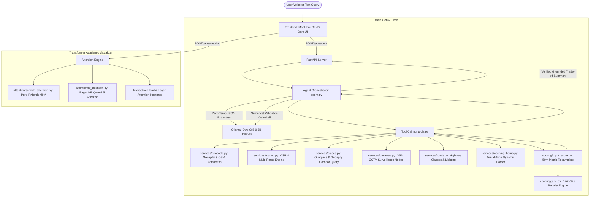
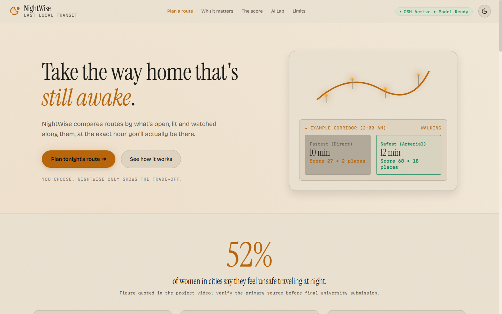
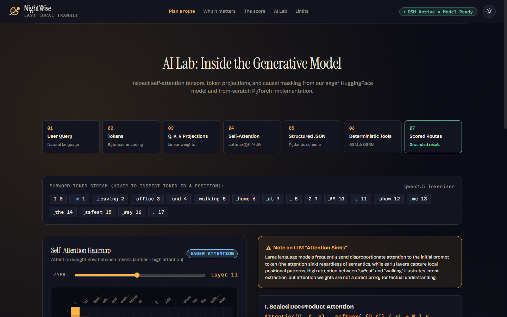
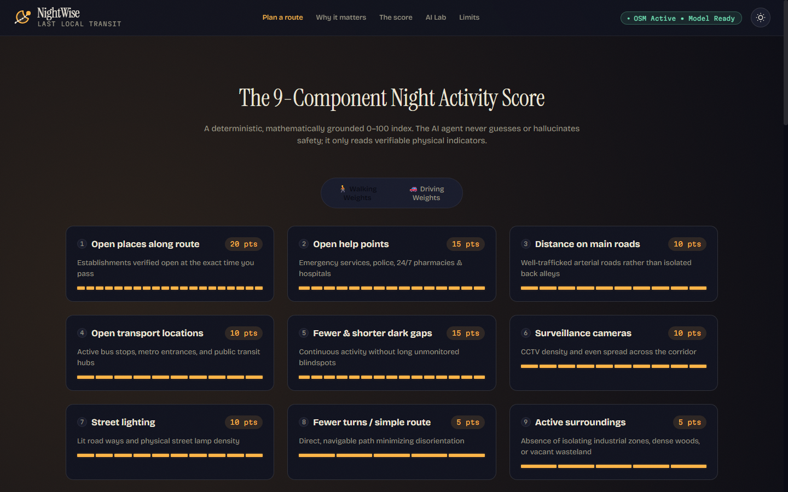
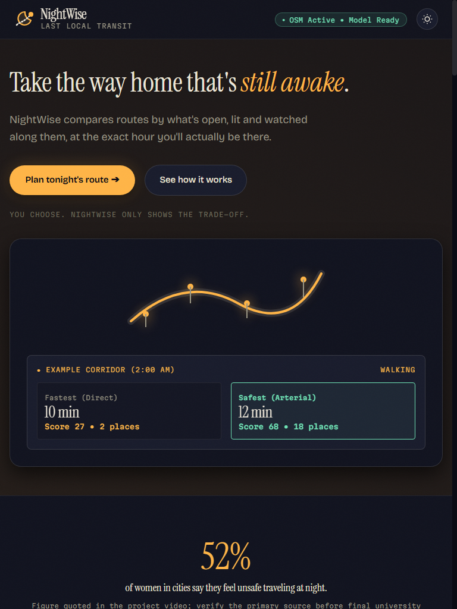
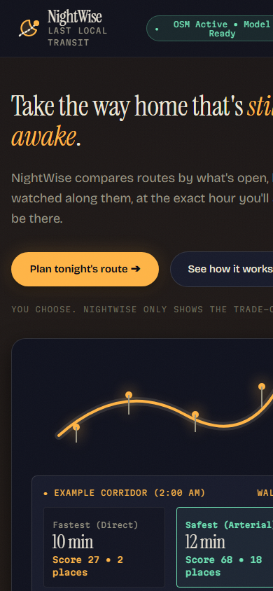

# NightWise AI 🌙

**A Safety-First Night Navigation Assistant with Grounded GenAI Orchestration & Interactive Transformer Attention Visualizations**

NightWise AI is an offline/online hybrid navigation platform tailored for night travelers in Indian cities. Instead of presenting only the single fastest route, NightWise computes **2 to 3 distinct alternative corridors side by side**, scoring each route with an explainable, deterministic **Night Activity Score (0–100)** based on mapped environmental-support indicators (active open venues, CCTV surveillance cameras, emergency help points, road classification, and street illumination). 

The app **never decides for the user**; it presents options and trade-offs (e.g. *"Fastest: 10 min, Night Score 38 vs. Safest: 13 min, Night Score 74 with 18 open places and 0 dark gaps"*).

---

## Architecture Diagram



---

## Key Features

1. **Deterministic & Explainable Night Activity Score (v2)**:
   - 9 distinct environmental components summing to 100 max points (walking and driving tables).
   - Resamples polyline every 25m (walking) or 50m (driving) in metric projection.
   - Evaluates dynamic arrival timestamp at each point (`departure_time + travel_time`).
   - Parses complex OSM `opening_hours` syntax (day intervals, overnight 18:00–03:00 shifts, 24/7). A place counts as open **only if open when the user passes it**.
   - Non-linear saturating curves $1 - \exp(-\text{density} / k)$ and 40m cluster deduplication ($1 + 0.3 \times \text{extra}$).
   - Penalizes continuous dark gaps non-linearly ($0.5 \times \text{longest} + 0.3 \times \text{p90} + 0.2 \times (1 - \text{evenness})$).
   - Fair comparison rescaling (Rule 9) when municipal lighting tags are $< 15\%$.
2. **Local Isolated GenAI Agent**:
   - Model weights stored exclusively in `./models/ollama` and `./models/hf` inside the project folder.
   - Pydantic schema validation with few-shot prompting (including Hinglish and informal phrasing).
   - Regex fallback parser and numerical guardrail verifying that generated explanations only cite factual numbers from the routing engine.
3. **GenAI Syllabus Mechanics & AI Lab**:
   - From-scratch PyTorch implementation of Multi-Head Attention (MHA) without `nn.MultiheadAttention`, including Sinusoidal Positional Encoding and Causal Masking.
   - Eager attention tensor extraction from HuggingFace `Qwen2.5-0.5B-Instruct` across all 24 layers and 14 heads.
   - 7-step horizontal storyboard stepper, square amber-to-ink heatmap with crosshairs, 14-head small-multiples grid, layer slider, and vertical SVG decoder block.
   - Honest scientific callouts highlighting LLM attention sinks.
4. **"Last Local" Transit Interface**:
   - Custom SVG logo, transit ticket cards with notched borders and dashed tear lines.
   - Semi-circular "lamp dial" SVG gauge with animated sweep and score counter.
   - Light-meter discrete pips (glowing amber) for all 9 score breakdown rows.
   - Dual-layer glowing street route lines and clustered POIs on OpenFreeMap dark vector tiles.
   - Warm Paper daylight theme with MapLibre style synchronization and verified Indian emergency helplines (112, 1091, 181, 1090).

---

## Design System: "Last Local" Transit Aesthetic

NightWise rejects generic startup templates and purple gradients in favor of **"Last Local"**: an editorial aesthetic inspired by late-night Indian city transit signage, paper tickets, and sodium-vapor streetlights reflecting off asphalt.

### 1. Typography
Self-hosted `.woff2` files in `frontend/fonts/` with `@font-face` and `font-display: swap`:
- **Headlines & Display**: *Instrument Serif* (with italic styling for poetic emphasis: *"still awake"*).
- **Interface & Prose**: *Bricolage Grotesque* (variable weight, high legibility).
- **Metrics & Telemetry**: *Martian Mono* (monospaced durations, points, coordinates, and confidence badges).

### 2. Palette & Themes
- **Night Asphalt (Default Dark)**: `--ink-950: #0A0B14`, `--ink-900: #11131F`, text `#ECE6D8`, sodium-lamp amber accent `--sodium: #FFB547` (`rgba(255, 181, 71, 0.22)` glow).
- **Warm Paper (Classroom Light)**: `--paper-50: #F4EDE0`, ink `#1B1A17`, accessible dark amber `#B8650A`. Theme toggle persists to `localStorage` and synchronizes MapLibre vector styles.
- **Semantic Accents**: Safe route mint `#6FE3B5`, dark gap coral `#FF5D5D`, fastest route steel-cyan `#7FC8F8`.

### 3. Captured Screenshots (`docs/screenshots/`)

| Viewport | Theme | Screenshot |
|---|---|---|
| **Desktop (1440 $\times$ 900)** | **Night Asphalt (Dark)** |  |
| **Desktop (1440 $\times$ 900)** | **Warm Paper (Light)** |  |
| **AI Lab (1440 $\times$ 900)** | **Transformer Visualizer** |  |
| **Score Matrix (1440 $\times$ 900)** | **Dynamic Weights & Slider** |  |
| **Tablet (768 $\times$ 1024)** | **Responsive Rail** |  |
| **Mobile (390 $\times$ 844)** | **Mobile Transit View** |  |

---

## Setup & Quick Start

### 1. Requirements
- Windows, macOS, or Linux.
- Python 3.10+ (tested with Python 3.14).
- Ollama installed on the system.

### 2. Virtual Environment Setup
```powershell
# Create and activate virtual environment
python -m venv .venv
.\.venv\Scripts\Activate.ps1

# Install project dependencies
python -m pip install -r requirements.txt
```

### 3. Environment Variables
Copy `.env.example` to `.env`:
```powershell
Copy-Item .env.example .env
```
Key configuration entries:
```env
GEOAPIFY_API_KEY=your_key_here    # Free key from geoapify.com (optional; system includes offline gazetteer & OSM fallbacks)
OLLAMA_MODELS=./models/ollama     # Models isolated strictly within the project folder
OLLAMA_HOST=http://127.0.0.1:11434
LLM_MODEL=qwen2.5:0.5b-instruct
HF_MODEL=Qwen/Qwen2.5-0.5B-Instruct
NIGHTWISE_HOST=127.0.0.1
NIGHTWISE_PORT=8000
```

### 4. Automatic Model Download & Verification
Run the automated idempotent setup script:
```powershell
python scripts/setup_models.py
```
This script:
- Creates `models/ollama/` and `models/hf/`.
- Starts Ollama with `OLLAMA_MODELS` bound to the local project directory.
- Pulls `qwen2.5:0.5b-instruct` into `./models/ollama`.
- Downloads `Qwen/Qwen2.5-0.5B-Instruct` into `./models/hf` using `snapshot_download`.
- Runs verification inference on both engines.

### 5. Run the Application
```powershell
python scripts/run.py
```
Open your browser at:
**http://127.0.0.1:8000**

---

## Scoring Formula & Weights (v2 Engine)

The NightWise v2 scoring engine evaluates routes deterministically using 9 distinct urban environmental components. Walking and driving use independent weight tables calibrated to mode-specific vulnerabilities, each summing to exactly 100 max points.

$$\text{Score} = \max\left(0, \min\left(100, \sum_{i=1}^{9} \text{Points}_i \times \text{RescaleFactor}\right)\right)$$

### 9-Component Weights Table (`backend/scoring/weights.py`)

| # | Component | Walking Max Pts | Driving Max Pts | Saturation Factor ($k$) | Description & Rationale |
|---|---|---|---|---|---|
| **1** | **Open Places Along Route** | **20.0 pts** | **15.0 pts** | $k = 8.0$ places/km | Verified open at user's passing time; active social presence ("eyes on the street") |
| **2** | **Open Help Points** | **15.0 pts** | **10.0 pts** | $k = 2.5$ points/km | Police stations, hospitals, emergency clinics, and 24/7 pharmacies |
| **3** | **Distance on Main Roads** | **10.0 pts** | **20.0 pts** | N/A (Linear ratio) | Share of route on primary/secondary arterials vs isolated service roads |
| **4** | **Open Transport Locations** | **10.0 pts** | **10.0 pts** | $k = 3.0$ stops/km | Active bus stops, metro entrances, transit hubs |
| **5** | **Fewer & Shorter Dark Gaps** | **15.0 pts** | **10.0 pts** | N/A (Composite ratio) | Penalizes long unmonitored blindspots ($0.5 \times \text{longest} + 0.3 \times \text{p90} + 0.2 \times (1 - \text{evenness})$) |
| **6** | **Surveillance Cameras** | **10.0 pts** | **5.0 pts** | $k = 4.0$ cams/km | Physical CCTV density combined with 200m corridor spread |
| **7** | **Street Lighting** | **10.0 pts** | **10.0 pts** | $k = 15.0$ lamps/km | Lit ways ratio (0.6x) + mapped street lamp density (0.4x) |
| **8** | **Fewer Turns / Simple Route**| **5.0 pts** | **10.0 pts** | Divisor = 6 (walk) / 4 (drive)| Douglas-Peucker angular simplicity; prevents navigational disorientation |
| **9** | **Active Surroundings** | **5.0 pts** | **10.0 pts** | Threshold = 300m / 500m | Absence of isolating industrial wastelands, dense woods, or vacant land |
| **Total** | | **100.0 pts** | **100.0 pts** | | Sums to exactly 100 for mathematical integrity |

### Key Mathematical Mechanics

1. **Non-Linear Diminishing Returns (Saturating Curves)**:
   $$\text{Points} = W_{\text{max}} \times \left(1 - \exp\left(-\frac{\text{density}}{k}\right)\right)$$
   Ensures that a modest number of open venues rapidly provides reassurance without allowing an excessive cluster of shops in one spot to inflate the score to 100.
2. **Cluster De-Duplication (40m Radius)**:
   Venues located within 40m of one another count as $1.0 + 0.3 \times \text{extras}$. A commercial mall with 20 shops is recognized as a single cluster rather than 20 individual checkpoints.
3. **Deep-Night Time Factor (01:00–04:00 AM)**:
   Venues that are not 24/7 or essential emergency services receive an automatic 0.6x dampener during the deep-night window (01:00 to 04:00), capturing the realistic drop in pedestrian foot traffic.
4. **Fair Comparison Rescaling (Rule 9)**:
   When municipal data for a component is unavailable across an area (e.g. lighting tags $< 15\%$ and zero mapped street lamps), the component is marked unavailable and the remaining 8 components are rescaled proportionally to 100 max points:
   $$\text{RescaleFactor} = \frac{100.0}{\sum_{c \in \text{Available}} W_c}$$
   This guarantees routes in developing or under-mapped localities are never unfairly penalized against heavily-tagged localities.
5. **Data Confidence Badge**:
   Evaluates tag density per km and mapped opening hours share to surface a `High`, `Medium`, or `Low` confidence badge, accompanied by a prominent warning if data is sparse.

---

## OpenStreetMap Primary Architecture & SQLite Caching

- **Primary Source**: OpenStreetMap queried via Overpass API with a multi-mirror failover rotator (`overpass-api.de`, `overpass.kumi.systems`, `overpass.private.coffee`), 25s timeout, exponential backoff, and concurrency rate limiting.
- **SQLite Tile Cache (`data/osm_cache.db`)**:
  - Automatically caches Overpass node and way data indexed by 0.01° grid tiles (~1.1 km $\times$ 1.1 km).
  - 7-day Time-To-Live (TTL) with sub-10ms query times.
  - Offline capability: `python scripts/prefetch_city.py "CityName"` pre-fetches and indexes municipal areas in advance.
- **Geoapify Role**: Demoted to autocomplete search and supplementary places provider (deduplicated against OSM within 25m and 0.4 name string similarity).
- **Map Vector Tiles**: OpenFreeMap dark vector tiles (`https://tiles.openfreemap.org/styles/dark`) served with full MapLibre GL JS interactivity and OpenStreetMap attribution.

---

## Automated Tests & Ablation

### Run PyTest Suite
```powershell
pytest -v tests/
```
The test suite validates:
- `test_opening_hours.py`: 24/7 parsing, overnight shifts (18:00–03:00), weekday closures, and unknown fallback weights.
- `test_attention.py`: Scratch attention tensor dimensions, causal masking, and softmax row sum normalization ($\sum_j A_{ij} = 1.0$).
- `test_scoring.py`: Closed venues do not count; CCTV presence raises scores; evenly spread activity outperforms clustered activity; walking and driving weights differ.
- `test_agent_parsing.py`: Evaluates parser accuracy across 32 varied real-world queries in `tests/queries.json`.

### Run Weight Ablation Experiment
```powershell
python scripts/ablation.py
```
Outputs empirical score deltas showing how scores change with and without cameras and with and without gap penalties.

---

## Limitations & Ethical Notice

1. **Not a Crime Prediction or Safety Guarantee**: The score is an objective environmental-support index reflecting physical urban indicators. It cannot predict criminal behavior or guarantee safety.
2. **OpenStreetMap Data Completeness**: Absence of a mapped streetlight or camera does not prove darkness or lack of surveillance. Unknown opening hours are discounted to 0.3 weight.
3. **Small Language Model Guardrail**: While `qwen2.5:0.5b-instruct` is extremely lightweight and fast for offline execution, all outputs are validated against deterministic schemas and raw figures.

---

## Future Work

- Integration of municipal streetlight telemetry (where available via smart city APIs).
- Live crowdsourced hazard reporting and temporary detour notices.
- Direct Bluetooth / SMS emergency contact sharing via Capacitor mobile builds.
