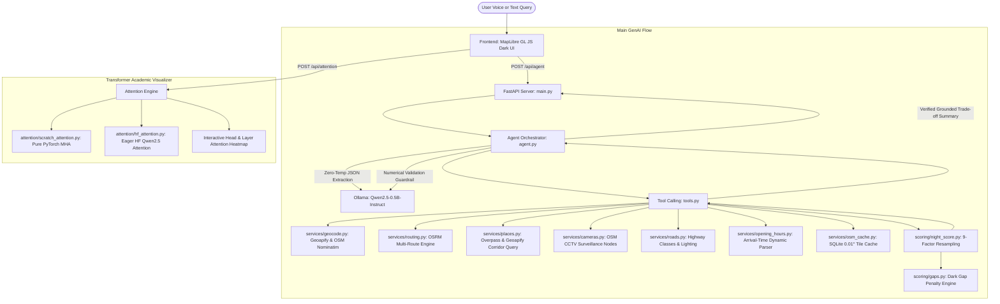

# safeMap 🌙

**Safety-First Night Navigation Platform with Grounded Local GenAI & Interactive Transformer Attention Visualizations**

[](https://www.python.org/downloads/)
[](https://fastapi.tiangolo.com)
[](https://pytorch.org/)
[](https://maplibre.org/)
[](LICENSE)

**safeMap** is an offline/online hybrid navigation platform designed for travelers in Indian cities. Instead of presenting only the single fastest route, safeMap computes **2 to 3 distinct alternative corridors side by side**, scoring each route with an explainable, deterministic **Night Activity Score (0–100)** based on mapped environmental-support indicators (active open venues, CCTV surveillance cameras, emergency help points, road classification, and street illumination).

The app **never decides for the user**; it presents options and trade-offs (e.g. *"Fastest: 10 min, Score 38 vs. Safest: 13 min, Score 74 with 18 open places and 0 dark gaps"*).

---

## Architecture Diagram



---

## Key Features

1. **Deterministic & Explainable Night Activity Score (v2)**:
   - 9 distinct environmental components summing to 100 max points (walking and driving tables).
   - Resamples polyline every 25m (walking) or 50m (driving) in metric projection.
   - Evaluates dynamic arrival timestamp at each point (`departure_time + travel_time`).
   - Parses complex OSM `opening_hours` syntax (day intervals, overnight 18:00–03:00 shifts, 24/7). A place counts as open **only if open when the user passes it**.
   - Non-linear saturating curves $1 - \exp(-\text{density} / k)$ and 40m cluster deduplication ($1 + 0.3 \times \text{extra}$).
   - Penalizes continuous dark gaps non-linearly ($0.5 \times \text{longest} + 0.3 \times \text{p90} + 0.2 \times (1 - \text{evenness})$).
   - Fair comparison rescaling when municipal lighting tags are $< 15\%$.

2. **100% Local AI & Privacy-First Architecture**:
   - Model weights stored exclusively in `./models/ollama` and `./models/hf` inside the project folder. Zero user location data sent to third-party cloud servers.
   - Pydantic schema validation with few-shot prompting (supports English and Hinglish phrasing like *"office se ghar jaana hai"*).
   - Numerical guardrail ensuring LLM summaries only cite verified facts from the routing engine.

3. **GenAI Syllabus Mechanics & AI Lab**:
   - From-scratch PyTorch implementation of Multi-Head Attention (MHA) without `nn.MultiheadAttention`, including Sinusoidal Positional Encoding and Causal Masking.
   - Eager attention tensor extraction from HuggingFace `Qwen2.5-0.5B-Instruct` across all 24 layers and 14 heads.
   - Interactive 2D attention matrix heatmap ($QK^T / \sqrt{d_k}$) rendered on HTML5 canvas with layer/head selectors and token attribution.

4. **Robust Mapping & UI**:
   - MapLibre GL JS vector maps using **OpenFreeMap** dark vector tiles with automatic fallback to **Carto Dark Matter** raster tiles.
   - Circular SVG Night Score gauge, 9-row glassmorphic breakdown card with interactive component filters, and category-coded POI markers.
   - Voice search via browser Web Speech API.
   - Mobile-ready container via **CapacitorJS**.

---

## Technology Stack

| Category | Technologies | Purpose |
|---|---|---|
| **Frontend** | HTML5, CSS3, JavaScript (Vanilla ES6+), HTML5 Canvas API | Reactive, dark OLED UI and 2D attention visualizers |
| **Mapping Engine** | MapLibre GL JS, OpenFreeMap, Carto Dark Matter, OpenStreetMap | Interactive WebGL vector & raster mapping |
| **Backend & API** | Python 3.10+, FastAPI, Uvicorn, HTTPX | High-concurrency async web server and REST API |
| **Data & Geometry** | Shapely, PyProj, SQLite 3, Geoapify API | Spatial buffering, polyline geometry, and 0.01° tile caching |
| **Routing** | OSRM (`routed-foot`, `routed-car`), Valhalla | Multi-alternative routing engine with overlap deduplication |
| **Local AI Models** | Qwen2.5-0.5B-Instruct, Ollama | Local natural language intent extraction and trade-off synthesis |
| **Deep Learning** | PyTorch (`torch`), Hugging Face `transformers`, `accelerate` | Multi-head attention extraction across 24 layers |
| **Mobile Shell** | CapacitorJS | Cross-platform runtime wrapper for Android and iOS |
| **Testing** | Pytest, AnyIO | 26 automated unit, regression, and real-city tests |

---

## Setup & Quick Start

### 1. Prerequisites
- **OS**: Windows, macOS, or Linux.
- **Python**: Version 3.10+ (tested up to Python 3.14).
- **Ollama**: Installed on the system ([ollama.com](https://ollama.com)).

### 2. Clone Repository & Setup Virtual Environment

#### On Windows (PowerShell):
```powershell
# Clone repository
git clone https://github.com/Anjali-7777/Nightwise-AI.git
cd Nightwise-AI

# Create and activate virtual environment
python -m venv .venv
.\.venv\Scripts\Activate.ps1

# Install dependencies
python -m pip install --upgrade pip
pip install -r requirements.txt
```

#### On Linux / macOS (Bash / Zsh):
```bash
# Clone repository
git clone https://github.com/Anjali-7777/Nightwise-AI.git
cd Nightwise-AI

# Create and activate virtual environment
python3 -m venv .venv
source .venv/bin/activate

# Install dependencies
pip install --upgrade pip
pip install -r requirements.txt
```

### 3. Environment Variables
Copy `.env.example` to `.env`:
```bash
cp .env.example .env
```
Default configuration:
```env
GEOAPIFY_API_KEY=your_key_here    # Free key from geoapify.com (optional; system includes offline gazetteer & OSM fallbacks)
OLLAMA_MODELS=./models/ollama     # Models isolated strictly within the project folder
OLLAMA_HOST=http://127.0.0.1:11434
LLM_MODEL=qwen2.5:0.5b-instruct
HF_MODEL=Qwen/Qwen2.5-0.5B-Instruct
NIGHTWISE_HOST=127.0.0.1
NIGHTWISE_PORT=8000
```

### 4. Download Local AI Models (One-Time Setup)
Run the automated setup script to pull the local models into the `./models/` directory:
```bash
python scripts/setup_models.py
```
This script:
- Creates isolated `./models/ollama` and `./models/hf` folders.
- Pulls `qwen2.5:0.5b-instruct` into Ollama.
- Downloads `Qwen/Qwen2.5-0.5B-Instruct` for Hugging Face transformer attention extraction.

### 5. Run the Application
Start the unified application server:
```bash
python scripts/run.py
```
Open your browser at:
- **Main App**: [http://127.0.0.1:8000](http://127.0.0.1:8000)
- **Nagpur Sample Corridor**: [http://127.0.0.1:8000/?origin=RUB+College+Nagpur&dest=VR+Mall+Nagpur](http://127.0.0.1:8000/?origin=RUB+College+Nagpur&dest=VR+Mall+Nagpur)
- **Transformer Attention Explorer**: [http://127.0.0.1:8000/#attention](http://127.0.0.1:8000/#attention)

---

## Scoring Formula & Weights (v2 Engine)

The safeMap v2 scoring engine evaluates routes deterministically using 9 distinct urban environmental components. Walking and driving use independent weight tables calibrated to mode-specific vulnerabilities, each summing to exactly 100 max points.

$$\text{Score} = \max\left(0, \min\left(100, \sum_{i=1}^{9} \text{Points}_i \times \text{RescaleFactor}\right)\right)$$

### 9-Component Weights Table (`backend/scoring/weights.py`)

| # | Component | Walking Max Pts | Driving Max Pts | Saturation Factor ($k$) | Description & Rationale |
|---|---|---|---|---|---|
| **1** | **Open Places Along Route** | **20.0 pts** | **15.0 pts** | $k = 8.0$ places/km | Verified open at user's passing time; active social presence ("eyes on the street") |
| **2** | **Open Help Points** | **15.0 pts** | **10.0 pts** | $k = 2.5$ points/km | Police stations, hospitals, emergency clinics, and 24/7 pharmacies |
| **3** | **Distance on Main Roads** | **10.0 pts** | **20.0 pts** | N/A (Linear ratio) | Share of route on primary/secondary arterials vs isolated service roads |
| **4** | **Open Transport Locations** | **10.0 pts** | **10.0 pts** | $k = 3.0$ stops/km | Active bus stops, metro entrances, transit hubs |
| **5** | **Fewer & Shorter Dark Gaps** | **15.0 pts** | **10.0 pts** | N/A (Composite ratio) | Penalizes long unmonitored blindspots ($0.5 \times \text{longest} + 0.3 \times \text{p90} + 0.2 \times (1 - \text{evenness})$) |
| **6** | **Surveillance Cameras** | **10.0 pts** | **5.0 pts** | $k = 4.0$ cams/km | Physical CCTV density combined with 200m corridor spread |
| **7** | **Street Lighting** | **10.0 pts** | **10.0 pts** | $k = 15.0$ lamps/km | Lit ways ratio (0.6x) + mapped street lamp density (0.4x) |
| **8** | **Fewer Turns / Simple Route**| **5.0 pts** | **10.0 pts** | Divisor = 6 (walk) / 4 (drive)| Douglas-Peucker angular simplicity; prevents navigational disorientation |
| **9** | **Active Surroundings** | **5.0 pts** | **10.0 pts** | Threshold = 300m / 500m | Absence of isolating industrial wastelands, dense woods, or vacant land |
| **Total** | | **100.0 pts** | **100.0 pts** | | Sums to exactly 100 for mathematical integrity |

### Key Mathematical Mechanics

1. **Non-Linear Diminishing Returns (Saturating Curves)**:
   $$\text{Points} = W_{\text{max}} \times \left(1 - \exp\left(-\frac{\text{density}}{k}\right)\right)$$
   Ensures that a modest number of open venues rapidly provides reassurance without allowing an excessive cluster of shops in one spot to inflate the score to 100.
2. **Cluster De-Duplication (40m Radius)**:
   Venues located within 40m of one another count as $1.0 + 0.3 \times \text{extras}$. A commercial mall with 20 shops is recognized as a single cluster rather than 20 individual checkpoints.
3. **Deep-Night Time Factor (01:00–04:00 AM)**:
   Venues that are not 24/7 or essential emergency services receive an automatic 0.6x dampener during the deep-night window (01:00 to 04:00), capturing the realistic drop in pedestrian foot traffic.
4. **Fair Comparison Rescaling**:
   When municipal data for a component is unavailable across an area (e.g. lighting tags $< 15\%$ and zero mapped street lamps), the component is marked unavailable and the remaining components are rescaled proportionally to 100 max points:
   $$\text{RescaleFactor} = \frac{100.0}{\sum_{c \in \text{Available}} W_c}$$
5. **Data Confidence Badge**:
   Evaluates tag density per km and mapped opening hours share to surface a `High`, `Medium`, or `Low` confidence badge.

---

## Operational Scripts & Utilities

- **Prefetch City for Fast Offline Use**:
  ```bash
  python scripts/prefetch_city.py --city "Nagpur"
  ```
  Downloads and indexes OSM corridors into `./data/osm_cache.db` so routing runs offline and avoids public Overpass rate-limits.

- **Run Automated Test Suite (26 Tests)**:
  ```bash
  pytest -v tests/
  ```

- **Verify Live Endpoints**:
  ```bash
  python scripts/verify_live.py
  ```

- **Run Scoring Ablation Study**:
  ```bash
  python scripts/ablation.py
  ```

---

## Ethical & Privacy Principles

1. **Local Compute First**: Your routes, timestamps, and locations remain on your device.
2. **Objective Environmental Index**: Night Activity Score measures mapped infrastructure (lighting, active venues, emergency help points), not crime prediction algorithms.
3. **User Agency**: The platform never forces a single route—it empowers the traveler with transparent trade-offs.

---

## License

This project is licensed under the MIT License - see the [LICENSE](LICENSE) file for details.
